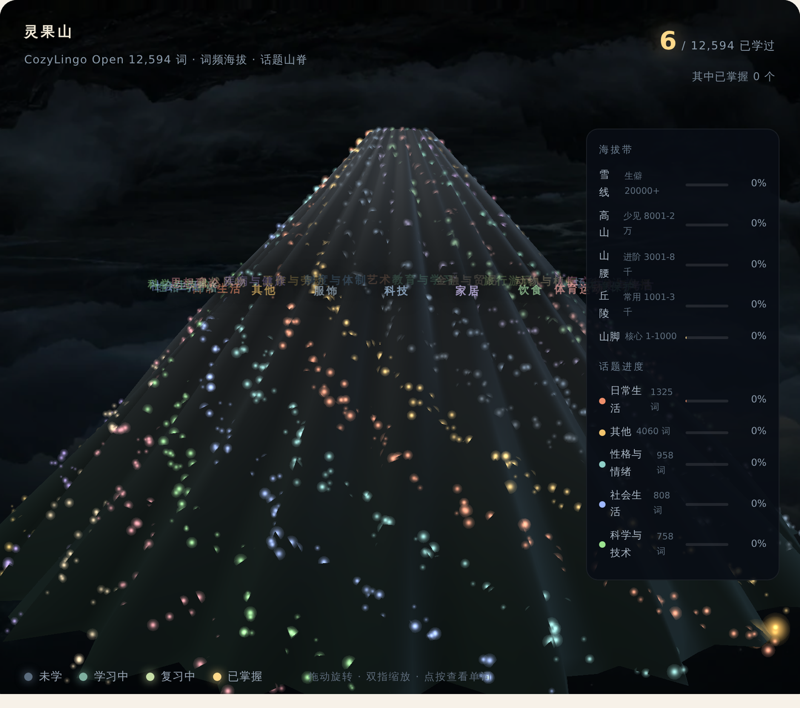

<div align="center">

<a href="https://litchixx-ob.github.io/cozylingo-open/"></a>

# CozyLingo Open

**12,594 English word entries · mnemonics · illustrations · UK/US IPA · examples · FSRS review · WebGL star map**

[**Try it online ↗**](https://litchixx-ob.github.io/cozylingo-open/)　/　[demo video](docs/assets/demo.mp4)　/　[download dataset](data/)　/　[中文](README.md)

[](LICENSE)
[](CONTENT_LICENSE.md)
[](data/words.json)
[](#run-locally)

</div>

---

**Version note**: this repo is the **open base edition** of CozyLingo — a working
**client-side vocabulary app** plus its dataset. The online site
([cozylingo.com](https://www.cozylingo.com)) evolves independently and may differ.
Code and content are licensed separately (MIT / CC BY 4.0).

## What it is

**Not a word-list dump — an app you can actually study with.** Clone it, serve it statically, done:

| View | What it does |
| :--- | :--- |
| **Library** | Search (English or Chinese), filter by word book / topic, open an entry for senses, examples and mnemonic |
| **Today's lesson** | **FSRS** picks what to review today; rate each word on five levels (forgot / hard / good / easy / mastered); progress stays on your device |
| **Star map** | All 12,594 words laid out as a WebGL mountain — topic = bearing, word frequency = altitude. Studied words light up, mastered ones turn gold |

**No account, no backend, no tracking** — progress lives in your own `localStorage` and can be exported / imported.

## Scale

| Item | Count |
| :--- | ---: |
| Entries | **12,594** (merged from 7 word books: junior / senior / CET-4 / CET-6 / postgraduate / TOEFL / SAT) |
| Senses | 1–3 per entry (POS + Chinese gloss + short English definition) |
| Examples | 0–2 per entry, English + Chinese |
| **Mnemonics** | **12,594 (100%)** — root/affix breakdown style |
| Illustrations | 12,594 × 512px + 12,594 × 256px WebP (shipped in the repo) |
| Audio | UK + US, pre-generated with Edge TTS (see [Releases](#audio), not in git) |
| Topic / frequency / exam tags | per entry (25 topics) |

## Preview

### Library


### Today's lesson — FSRS scheduling and five-level rating


Scheduling isn't random: due reviews come first (optionally wrong-answers-first), then new words by
frequency rank; mastered words graduate out of the queue. Algorithm and parameters:
**[docs/fsrs.md](docs/fsrs.md)**.

### Star map



Drag to rotate, scroll to zoom, click a star to see the word. Progress comes from your local study record.

<details>
<summary><b>Watch the 62-second demo</b></summary>

<a href="docs/assets/demo.mp4"></a>

[Full video](docs/assets/demo.mp4)

</details>


## Run locally

**Zero dependencies, zero build step.** Any static server works:

```bash
git clone --depth 1 https://github.com/litchixx-ob/cozylingo-open.git
cd cozylingo-open
python3 -m http.server 8000
# open http://localhost:8000
```

Or just take the data:

```python
import json
ws = json.load(open("data/words.json", encoding="utf-8"))["words"]
print(len(ws))                       # 12594

for w in sorted((x for x in ws if x["topic"] == "科学与技术"), key=lambda x: x["frequency"])[:5]:
    print(w["word"], "|", w["senses"][0]["zh"], "|", w["remmethod"])
```

Field reference: [docs/dataset.md](docs/dataset.md).

## Audio

About **300 MB** of pre-generated speech (25,188 clips: 12,594 words × UK/US). It is **not stored in
git** — download `audio-us.zip` / `audio-uk.zip` from [**Releases**](../../releases) and unpack into
`data/audio/`:

```
data/audio/us/<id>.mp3
data/audio/uk/<id>.mp3
```

**Optional** — if a clip is missing, the app falls back to the browser's built-in speech synthesis.

Regenerate with your own voices:

```bash
pip install -U 'edge-tts>=7.3.1'     # ⚠️ 7.3.1+ required; 7.2.x gets a 403 from the endpoint
python3 scripts/gen_audio.py --concurrency 6
```

## Building your own pack

The dataset is compiled, not hand-written:

```bash
python3 scripts/build_orchard.py      # words.json → orchard.json (compact format for the star map)
python3 scripts/check_dataset.py      # structure validation (also runs in CI)
python3 scripts/build_manifest.py     # regenerate PUBLIC_MANIFEST.json
```

## License

| Scope | License |
| :--- | :--- |
| App code (`index.html`, `src/`) | [MIT](LICENSE) |
| Dataset, illustrations | [CC BY 4.0](CONTENT_LICENSE.md) |
| Headwords / IPA / definitions / examples | from [kylebing/english-vocabulary](https://github.com/kylebing/english-vocabulary) (BSD-3-Clause, full text included) |
| Mnemonics / topics / frequency / illustrations | original to this project |
| Star map shaders | rendering parameters from [designfuchen/word-atlas](https://github.com/designfuchen/word-atlas) (MIT) |
| FSRS engine | same implementation as the production service, see header of `src/fsrs.js` |

**Not included**: exam papers, textbook passages, or commercial dictionary audio recordings.

## Contributing

The most valuable contribution is **fixing content errors** (the dataset has not been proofread
entry by entry). See [CONTRIBUTING.md](CONTRIBUTING.md).

---

If this project is useful to you, a star is appreciated.
