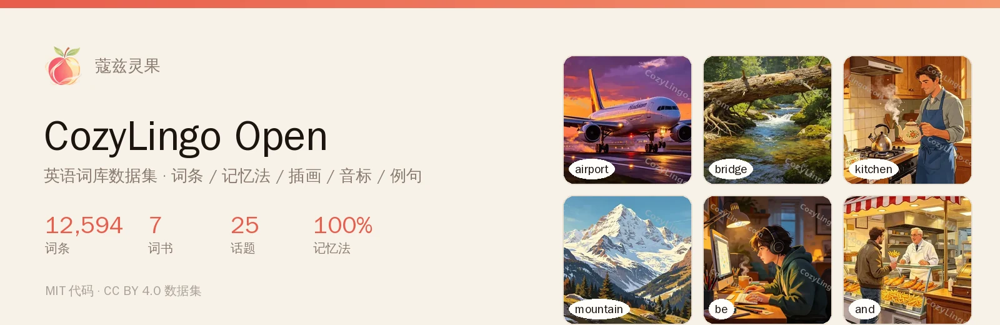
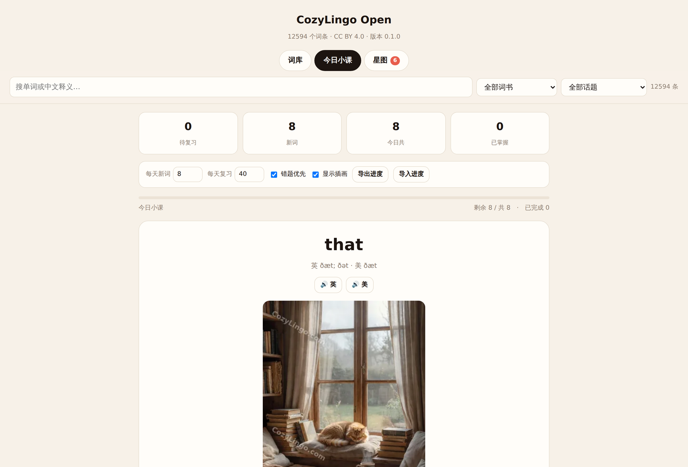
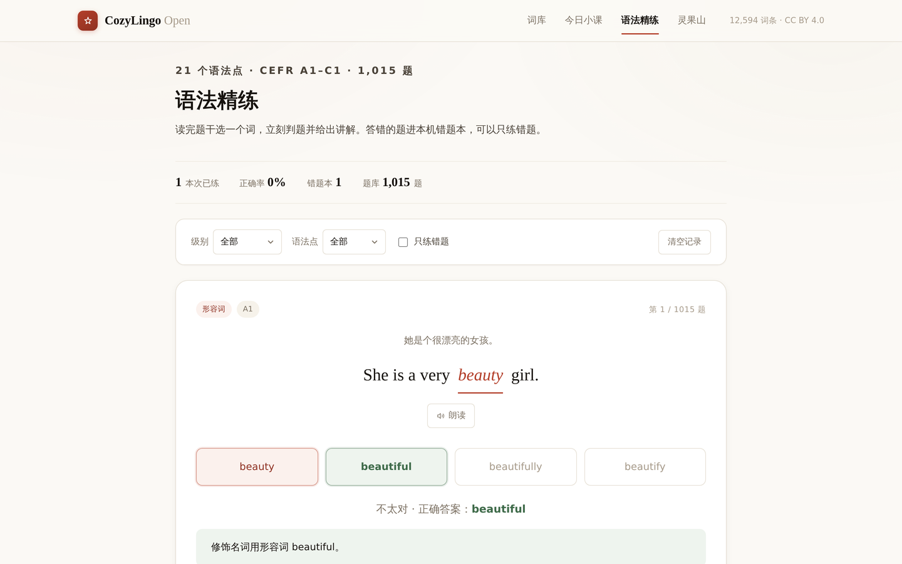
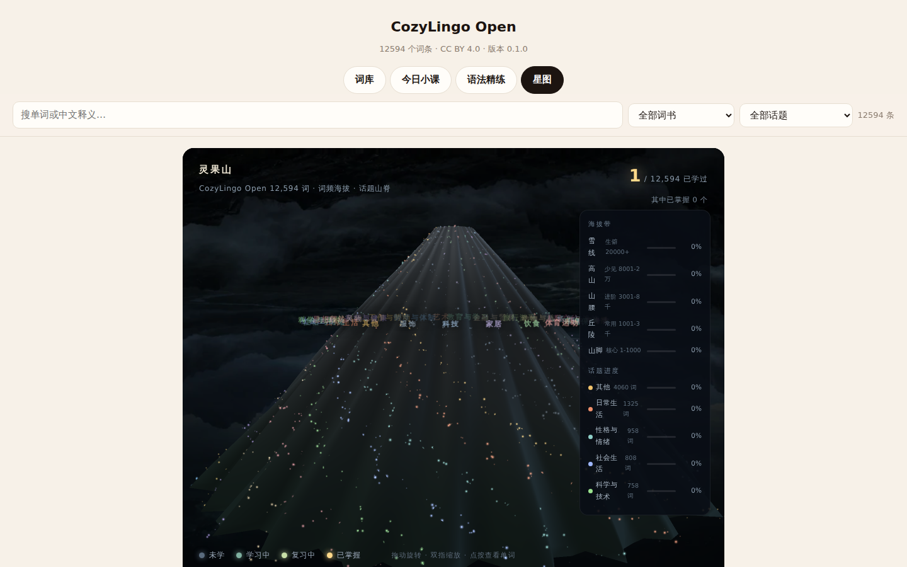
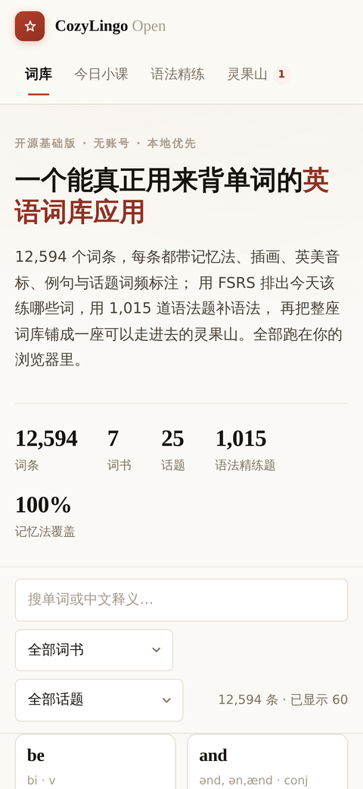
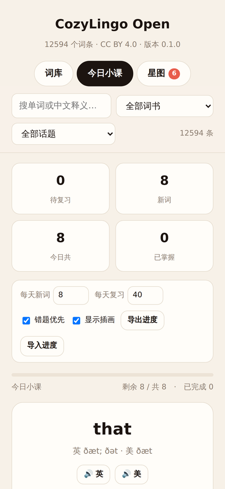
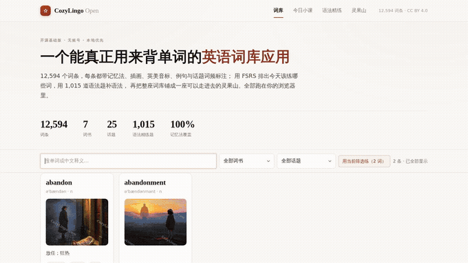

<div align="center">

<a href="https://www.cozylingo.com"></a>

# CozyLingo Open · 蔻兹灵果开源词库

**12,594 个英语词条 · 记忆法 · 插画 · 英美音标 · 例句 · FSRS 间隔复习 · 1,015 道语法题 · 灵果山进度**

[**在线试用（线上完整版）↗**](https://www.cozylingo.com)　/　[演示视频](docs/assets/demo.mp4)　/　[下载词库](data/)　/　[English](README.en.md)

[](LICENSE)
[](CONTENT_LICENSE.md)
[](data/words.json)
[](#本地运行)

</div>

---

**版本说明**：本仓库是 CozyLingo 的**开源基础版** —— 一个能真正用来背单词的**纯前端应用**，外加配套词库数据集。

上面的「在线试用」指向**线上完整版**（[cozylingo.com](https://www.cozylingo.com)，有账号体系与更多内容），
它与本仓库独立迭代、功能可能不同。想跑**本仓库这个开源版**，按下面的「[本地运行](#本地运行)」起一个静态服务即可 ——
零依赖、零构建、约 30 秒。

代码与内容分别遵循 MIT / CC BY 4.0 授权。

## 这是什么

**不是词表 dump，是一个能跑的应用。** clone 下来、起一个静态服务就能背单词：

| 视图 | 做什么 |
| :--- | :--- |
| **词库** | 搜词（中英文都可搜）、按词书 / 话题筛选、点开看释义·例句·记忆法 |
| **今日小课** | 用 **FSRS** 排出今天该练的词，五档评分（不会 / 困难 / 良好 / 简单 / 已掌握），进度存本机 |
| **语法精练** | **1,015 道完形填空**（21 个语法点 × A1–C1），选完立刻判题并给讲解；答错的进错题本，可只练错题 |
| **灵果山** | 12,594 个词按「话题 = 方位、词频 = 海拔」铺成一座 WebGL 山，学过的词点亮、掌握的变金色 |

**无账号、无后端、无埋点**：进度只存在你自己的 `localStorage` 里，可导出 / 导入。

## 数据规模

| 项 | 数量 |
| :--- | ---: |
| 词条 | **12,594**（来自 7 个词书：初中 / 高中 / 四级 / 六级 / 考研 / 托福 / SAT） |
| 义项 | 每条 1–3 个（词性 + 中文释义 + 简明英文释义） |
| 例句 | 每条 0–2 条，英文 + 中译 |
| **记忆法** | **12,594 条（100%）** —— 词根词缀拆解式 |
| 插画 | 12,594 张 512px + 12,594 张 256px（WebP，已随仓库分发） |
| 发音 | 英美双音，Edge TTS 预生成（走 [Releases](#发音音频) 下载，不进 git） |
| 话题 / 词频 / 考试标签 | 每条附带（25 个话题） |
| **语法题（完形填空）** | **1,015 道**，21 个语法点 × A1–C1，**AI 生成**、每题带讲解与中文释义 |

## 预览

### 词库：搜得到、筛得动


### 今日小课：FSRS 排课 + 五档评分



排课不是随机抽词：先排到期的复习（可开「错题优先」），再按词频补新词，已掌握的词毕业出队。
算法细节与参数见 **[docs/fsrs.md](docs/fsrs.md)**。

### 语法精练：1,015 道完形填空



题库覆盖 21 个语法点（时态 110 / 综合 90 / 句子结构 60 / 词汇辨析 70 / 代词 55 / 条件句 55 / 介词 55 / …），
按 CEFR 分级（A1 100 / A2 210 / B1 320 / B2 239 / C1 146）。答错的题进本机错题本，可切换「只练错题」。

> 这些题是 **AI 生成**的（授权 CC BY 4.0），与线上站点使用的题库无关 —— 线上那批题干来自第三方站点，不随本仓库分发。

### 灵果山：学过的词会亮



拖动旋转、滚轮缩放、点按查看单词。进度来自本机学习记录，没有数据也能看形状。

<table>
<tr>
<td width="50%"></td>
<td width="50%"></td>
</tr>
<tr><td align="center">手机端词库</td><td align="center">手机端今日小课（含跟读式大字）</td></tr>
</table>

<details>
<summary><b>看 62 秒演示</b></summary>

<a href="docs/assets/demo.mp4"></a>

[播放完整视频](docs/assets/demo.mp4)

</details>



## 本地运行

**零依赖、零构建**。只要有 Python 或任意静态服务器：

```bash
git clone --depth 1 https://github.com/litchixx-ob/cozylingo-open.git
cd cozylingo-open
python3 -m http.server 8000
# 打开 http://localhost:8000
```

只想要数据也可以：

```python
import json
ws = json.load(open("data/words.json", encoding="utf-8"))["words"]
print(len(ws))                       # 12594

# 「科学与技术」话题里最常用的 5 个词，连记忆法一起拿
for w in sorted((x for x in ws if x["topic"] == "科学与技术"), key=lambda x: x["frequency"])[:5]:
    print(w["word"], "|", w["senses"][0]["zh"], "|", w["remmethod"])
```

字段说明见 [docs/dataset.md](docs/dataset.md)。

## 发音音频

音频约 **300 MB**（25,188 段：12,594 词 × 英美双音），**不放在 git 里**，去
[**Releases**](../../releases) 下载 `audio-us.zip` / `audio-uk.zip`，解压到 `data/audio/`：

```
data/audio/us/<id>.mp3
data/audio/uk/<id>.mp3
```

**不装也能用** —— 找不到音频文件时，应用会自动回退到浏览器自带的语音合成（Web Speech API）。

想用自己的音色重新生成：

```bash
pip install -U 'edge-tts>=7.3.1'     # ⚠️ 必须 ≥7.3.1，7.2.x 会被服务端 403
python3 scripts/gen_audio.py --concurrency 6
```

## 自己造数据包

数据不是手写的，是从上游词表编译出来的。想换成你自己的词表：

```bash
python3 scripts/build_cloze.py        # _gen/b*.json → data/cloze.json（题库合并 + 校验）
python3 scripts/build_orchard.py      # words.json → orchard.json（灵果山用的紧凑格式）
python3 scripts/check_dataset.py      # 结构校验（CI 也跑这个）
python3 scripts/build_manifest.py     # 重新生成 PUBLIC_MANIFEST.json
```

## 授权

| 范围 | 许可 |
| :--- | :--- |
| 应用代码（`index.html` / `src/`） | [MIT](LICENSE) |
| 词库内容、插画 | [CC BY 4.0](CONTENT_LICENSE.md) |
| 词头 / 音标 / 释义 / 例句 | 来自 [kylebing/english-vocabulary](https://github.com/kylebing/english-vocabulary)（BSD-3-Clause，许可全文已附） |
| 记忆法 / 话题 / 词频 / 插画 | 本项目原创 |
| 语法题与讲解 | **本项目 AI 生成**，CC BY 4.0（非第三方题库） |
| 灵果山着色器 | 渲染参数源自 [designfuchen/word-atlas](https://github.com/designfuchen/word-atlas)（MIT） |
| FSRS 引擎 | 本项目线上服务端同款实现，见 `src/fsrs.js` 头部说明 |

**不包含**：各类考试真题、教材课文原文、商业词典的真人发音音频。

## 参与贡献

最有价值的贡献是**纠错**（词库未经逐条人工审校）。见 [CONTRIBUTING.md](CONTRIBUTING.md)。

---

如果这个项目对你有用，欢迎 Star，或分享给正在学英语的朋友。
