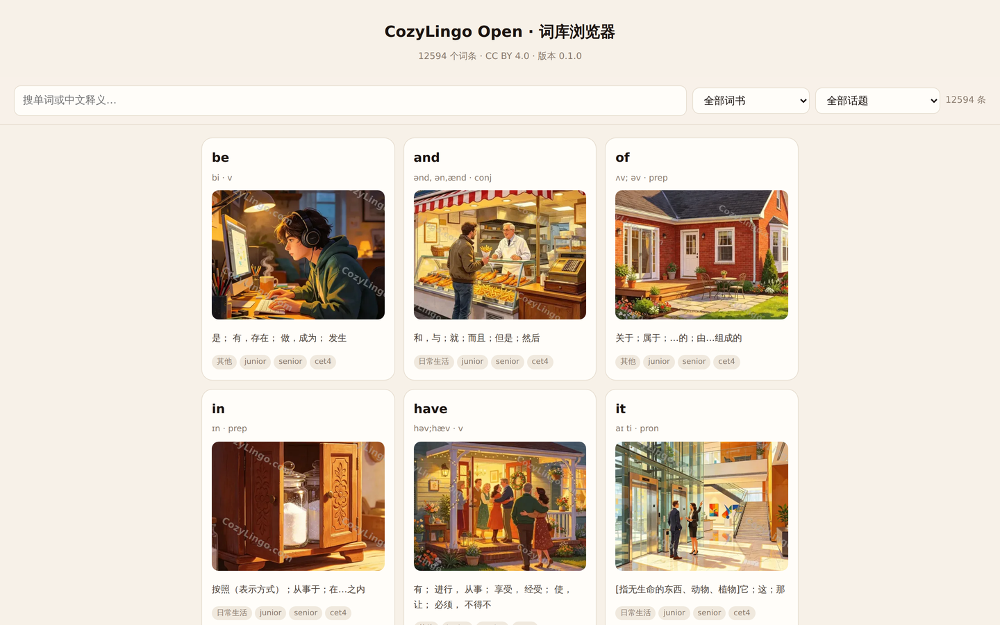
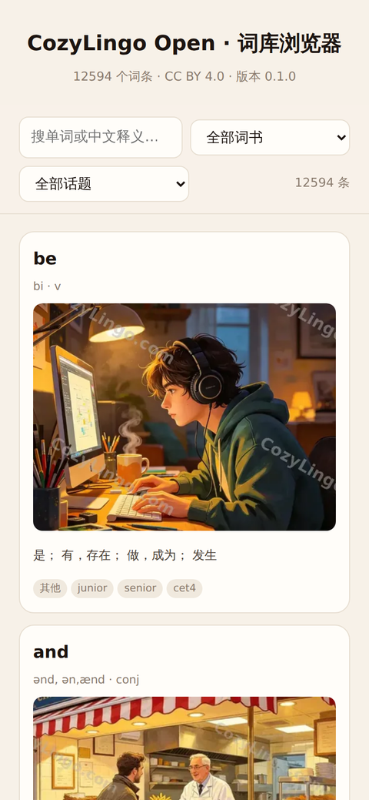
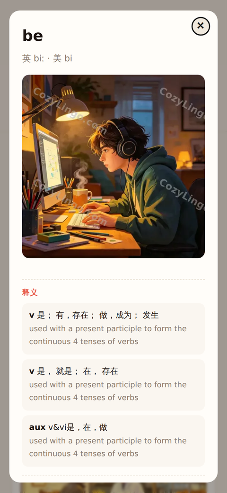

<div align="center">

<a href="https://litchixx-ob.github.io/cozylingo-open/"></a>

# CozyLingo Open · 蔻兹灵果开源词库

**12,594 个英语词条 · 记忆法 · 插画 · 英美音标 · 例句 · 话题与词频标注**

[**在线浏览 ↗**](https://litchixx-ob.github.io/cozylingo-open/)　/　[演示视频](docs/assets/demo.mp4)　/　[下载词库](data/)　/　[English](README.en.md)

[](LICENSE)
[](CONTENT_LICENSE.md)
[](data/words.json)

</div>

---

**版本说明**：本仓库提供词库数据与配套的读取页面。在线网站（[cozylingo.com](https://www.cozylingo.com)）独立迭代，功能与仓库可能不同；代码与内容分别遵循 MIT / CC BY 4.0 授权。

## 这是什么

一个可以直接拿来用的**英语词库数据集**：每个词条带**词根词缀记忆法**、**插画**、英美音标、中英对照例句、话题分类与词频序号。

数据来自 7 个词书（初中 / 高中 / 四级 / 六级 / 考研 / 托福 / SAT），合并去重后 12,594 词，**记忆法 100% 覆盖**。

## 数据规模

| 项 | 数量 |
| :--- | ---: |
| 词条 | **12,594** |
| 词书 | 7（初中 1,991 · 高中 3,753 · 四级 4,544 · 六级 3,992 · 考研 5,057 · 托福 10,377 · SAT 4,464，合并去重后 12,594） |
| 义项 | 每条 1–3 个（词性 + 中文释义 + 简明英文释义） |
| 例句 | 每条 0–2 条，英文 + 中译 |
| **记忆法** | **12,594 条（100%）** —— 词根词缀拆解式 |
| 插画 | 12,594 张 512px 主图 + 12,594 张 256px 缩略图（WebP） |
| 话题 | 25 类；未标注的归「其他」 |
| 词频 / 考试标签 | 每条附带 |

## 预览

### 一本可以搜、可以筛、点开就能看的词库



<table>
<tr>
<td width="50%"></td>
<td width="50%"></td>
</tr>
<tr><td align="center">手机端：自适应单列</td><td align="center">点开看释义、例句与记忆法</td></tr>
</table>

<details>
<summary><b>看 53 秒演示</b></summary>

<a href="docs/assets/demo.mp4"></a>

[播放完整视频（含操作过程）](docs/assets/demo.mp4)

</details>


## 直接用

仓库自带一个**零依赖**的词库浏览器（`index.html`），不需要构建、不需要后端：

```bash
git clone --depth 1 https://github.com/litchixx-ob/cozylingo-open.git
cd cozylingo-open
python3 -m http.server 8000
# 打开 http://localhost:8000
```

或者只取数据：

```python
import json
ws = json.load(open("data/words.json", encoding="utf-8"))["words"]
print(len(ws))                       # 12594

# 挑「科学与技术」话题里最常用的 5 个词
top = sorted((w for w in ws if w["topic"] == "科学与技术"), key=lambda w: w["frequency"])[:5]
for w in top:
    print(w["word"], "|", w["senses"][0]["zh"], "|", w["remmethod"])
```

字段说明见 [docs/dataset.md](docs/dataset.md)。

## 授权

| 范围 | 许可 |
| :--- | :--- |
| 页面代码 | [MIT](LICENSE) |
| 词库内容 | [CC BY 4.0](CONTENT_LICENSE.md)，其中词头/音标/释义/例句来自 [kylebing/english-vocabulary](https://github.com/kylebing/english-vocabulary)（BSD-3-Clause，已附许可全文） |

**不包含**：各类考试真题、教材课文原文、商业词典的真人发音音频。

## 参与贡献

最有价值的贡献是**纠错**（词库未经逐条人工审校）。见 [CONTRIBUTING.md](CONTRIBUTING.md)。

---

如果这个数据集对你有用，欢迎 Star，或分享给正在学英语的朋友。
